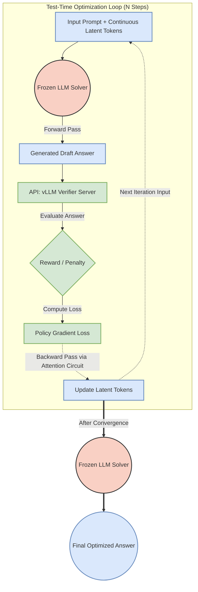

# Dự án Eureka

**Dự án cho quá trình Suy luận ẩn cấp độ cá thể tại thời điểm kiểm thử (Test-Time Instance-Level Latent Reasoning)**

Tập trung giải quyết bài toán: **Làm sao để một mô hình ngôn ngữ (LLM) suy luận thông minh hơn, giải toán giỏi hơn mà không cần phải train (fine-tune) lại toàn bộ mô hình?**

Đây là một phương pháp suy luận ẩn tại thời điểm kiểm thử (test-time) dành cho các mô hình transformer tự hồi quy (autoregressive transformers) đã bị đóng băng trọng số. 

Phương pháp này đặt một tập nhỏ các token ẩn liên tục (continuous latent tokens) trực tiếp vào chuỗi embedding đầu vào của transformer, ngay cạnh prompt đầu vào. Các token sinh ra sẽ attend tới các token ẩn này thông qua cơ chế tự chú ý (self-attention) tiêu chuẩn. Cùng lúc đó, gradient xác suất của token sẽ flow backward qua chính các kết nối attention đó để phân bổ đóng góp (assign credit) và tối ưu hóa từng token ẩn.

Đối với mỗi bài toán, GradCuit đánh giá câu trả lời được sinh ra bằng một mô hình xác minh (verifier) duy nhất và áp dụng bản cập nhật theo kiểu **policy-gradient** lên các token ẩn. Các tham số của mô hình ngôn ngữ (LLM) vẫn được đóng băng hoàn toàn; chỉ các token ẩn đặc thù cho từng bài toán mới được cập nhật trước khi tiến hành sinh lại câu trả lời.

Bản cài đặt này hỗ trợ các tập dữ liệu GSM8K, MATH-500 và GPQA-Diamond. Quá trình trích xuất câu trả lời và đánh giá độ chính xác cuối cùng sử dụng cùng một luồng đánh giá giống như các thí nghiệm verifier đơn lẻ ban đầu.

---

## Architecture

Dưới đây là sơ đồ diễn giải kiến trúc của GradCuit:



---

## Installation

Yêu cầu Python 3.10 trở lên. Hãy cài đặt bản build PyTorch tương thích với CUDA cho hệ thống của bạn, sau đó chạy:

```bash
pip install -r requirements.txt
```

Quá trình đánh giá MATH-500 sử dụng trình phân tích cú pháp `latex2sympy2==1.9.0` nguyên bản với `antlr4-python3-runtime==4.11.1`, khớp với môi trường nguyên bản của GradCuit.

Mô hình xác minh (verifier) sử dụng một máy chủ vLLM tương thích với OpenAI. Trình giải toán (solver) và trình xác minh (verifier) thông thường chạy trên các tiến trình (processes) riêng biệt và có thể sử dụng các GPU khác nhau.

## Quick Start

Chỉnh sửa các thiết lập tĩnh của GPU và mô hình trong hai script ví dụ. Khởi chạy trình xác minh trước:

```bash
bash scripts/start_verifier.sh
```

Sau đó chạy ví dụ GradCuit:

```bash
bash scripts/run_example.sh
```

Ví dụ này sử dụng định danh mô hình công khai `meta-llama/Llama-3.2-3B-Instruct`, tập dữ liệu GSM8K, thư mục đầu ra tương đối `./output`, learning rate là `0.001`, và số token mới tối đa là `2048`. Nó tối ưu hóa đoạn tiền tố (prefix) được chèn vào tại đầu vào của khối giải mã (decoder block) thứ `14`, tức là vị trí chính giữa của 28 khối giải mã của mô hình.

GPQA Diamond là một tập dữ liệu giới hạn (gated). Hãy chấp nhận các điều khoản dữ liệu của nó và xác thực bằng tài khoản Hugging Face trước khi sử dụng `gpqa_diamond`.

## Main Arguments

`src/main.py` yêu cầu khai báo tường minh tất cả các tham số định hình thí nghiệm. Hãy chạy:

```bash
python src/main.py --help
```

- `--solver_prompt_idx` nhận giá trị `0` cho các câu trả lời đóng khung (boxed answers) và `1` cho định dạng JSON.
- `--optimize_layer_idx 0` để tối ưu hóa prefix embeddings; giá trị dương sẽ tối ưu hóa trạng thái ẩn của prefix (prefix hidden state) tại đầu vào của khối giải mã tương ứng đó. 
- `--optimizer` nhận các giá trị `adam`, `sgd`, hoặc `muon`.
- `--max_num_steps` phải là số dương; bài báo sử dụng `10`. 
- Đặt `--grad_clip 0` để vô hiệu hóa việc cắt bớt gradient (clipping) và `--num_data -1` để xử lý toàn bộ các ví dụ còn lại.

Sử dụng cờ `--resume` với cùng các tham số thí nghiệm để tiếp tục chạy từ thư mục đầu ra mới nhất phù hợp.
API key, khi cần, sẽ được đọc từ biến môi trường `VLLM_API_KEY`.

## Outputs

Mỗi lần chạy sẽ ghi ra các tệp sau:

- `run_args.json`: Các thiết lập thí nghiệm đã được làm sạch.
- `test/<index>_data.json`: Prompt, đầu ra gốc, lịch sử quá trình tối ưu hóa, và kết quả đúng/sai cuối cùng.
- `logistics.pt`: Trạng thái tiếp tục (resume state) và các bộ đếm tổng hợp.

Các tệp sinh ra ở đầu ra sẽ bị bỏ qua bởi Git (thông qua `.gitignore`).
